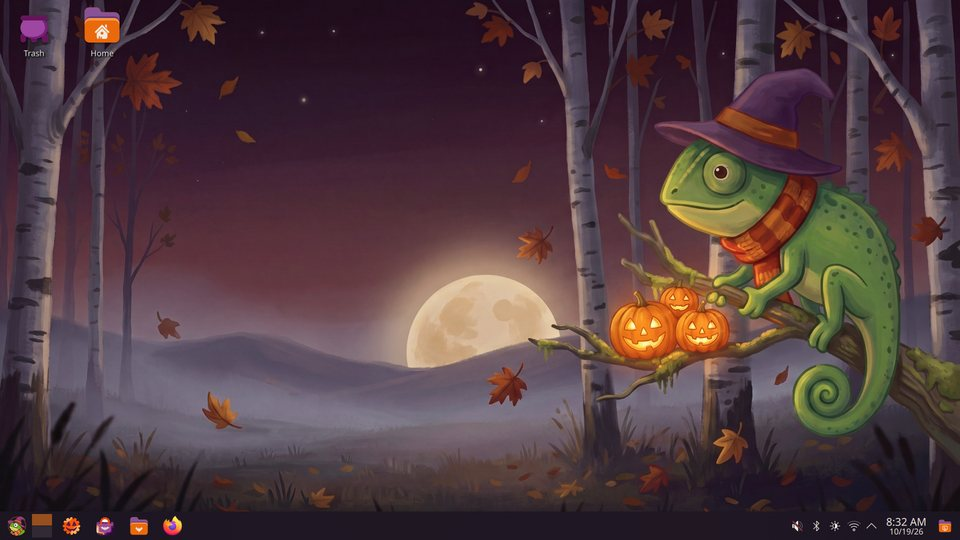

# halloween-openSUSE

A cosy autumn Halloween theme for openSUSE Tumbleweed with KDE Plasma: warm
candle-lit colours, falling leaves, carved pumpkins and a friendly chameleon in
a witch hat.

[](https://github.com/plusky/halloween-openSUSE/actions/workflows/check.yml)
[-blue)](#licence)
[](https://kde.org/plasma-desktop/)
[](https://get.opensuse.org/tumbleweed/)


| | |
|---|---|
|  |  |
| App launcher | Dolphin with the folder icons |
|  |  |
| The wallpaper at night | Login screen (SDDM) |
|  |  |
| File types | Firefox theme |
|  |  |
| Splash screen | Pumpkin clock |

## What's included

| Piece | ID | Works with |
|---|---|---|
| Wallpaper: dusk by day, moonlit by night | `openSUSEhalloween` | Plasma desktop and lock screen |
| Plasma style: autumn colours, leaf sprig on popups, ember tooltip glow, pumpkin clock | `openSUSE-halloween` | Plasma |
| Colour scheme | `openSUSEHalloween` | Plasma and KDE apps |
| Global theme with a pumpkin splash screen | `org.openSUSE.halloween.desktop` | Plasma |
| Icon theme over Breeze Dark: folders, file types, drives, trash, KDE apps, a web-browser icon (also for Firefox), app-menu and power icons | `openSUSE-halloween` | any freedesktop desktop |
| Login screen, built on openSUSE's `breeze-openSUSE` | `breeze-openSUSE-halloween` | SDDM |
| Boot splash | `openSUSE-halloween` | Plymouth |
| Firefox theme: plum toolbars, pumpkin accents, the moonlit forest behind the tabs | `openSUSE-halloween@pluskal.org` | Firefox |

openSUSE's green and blue are replaced by an all-autumn palette
([`art/palette.toml`](art/palette.toml)); openSUSE green appears only on the
chameleon. KDE Plasma is the first desktop; [GNOME](gnome/) and [Xfce](xfce/)
are planned, and the wallpapers, icons, boot splash and Firefox theme in
[`shared/`](shared/) already work there.

## Requirements

- openSUSE Tumbleweed with KDE Plasma 6.8 or newer and the openSUSE branding
  (the `breeze-openSUSE` SDDM theme and `plymouth`)
- systemd-boot with `sdbootutil`, for the boot splash
- To build: Python 3.11 or newer, `make` and [Git LFS](https://git-lfs.com/)

## Install

On the openSUSE machine, from a checkout of this repository:

```bash
git lfs install && git lfs pull
make build
build/install/install-user.sh                   # wallpaper, Plasma style, colours, icons, splash
sudo build/install/install-root.sh              # login screen; installs the boot splash
sudo build/install/install-root.sh --plymouth   # after trying it: make it the boot splash
build/install/verify.sh                         # report what is active
```

- The user install keeps your panels and widgets, and saves your previous
  settings on its first run.
- `install-root.sh --files` installs without switching anything, so you can
  try the login screen first.
- The boot splash only becomes active with `--plymouth`, which also rebuilds
  the initrds; until then a kernel update can't pick it up by surprise.

### Uninstall

```bash
build/install/uninstall-user.sh        # restores your previous Plasma settings
sudo build/install/uninstall-root.sh   # restores the login screen and boot splash
```

### If the boot splash causes trouble

- Press <kbd>Esc</kbd> during boot to see the text log.
- Hold <kbd>Space</kbd> at power-on to open the systemd-boot menu and pick an
  older snapshot, or press <kbd>e</kbd> and add `plymouth.enable=0`.
- From a text console (<kbd>Ctrl</kbd>+<kbd>Alt</kbd>+<kbd>F3</kbd>), run
  `sudo build/install/uninstall-root.sh`.

### Firefox

`make build` makes `build/firefox/openSUSE-halloween.xpi`. It only recolours
Firefox; Firefox's own logo stays as it is. The `.xpi` isn't signed by
Mozilla, and regular Firefox releases only install signed add-ons:

- **openSUSE's Firefox, for everyone on the machine:** openSUSE builds Firefox
  to load add-ons from its own folder. The file name must be the add-on ID:

  ```bash
  sudo install -Dm644 build/firefox/openSUSE-halloween.xpi "/usr/lib64/firefox/browser/extensions/openSUSE-halloween@pluskal.org.xpi"
  ```

  Restart Firefox, then pick the theme in `about:addons` → *Themes*. Firefox
  doesn't check signatures in that folder, so only put files there that you
  built or trust. To remove it, pick another theme and delete the file.
- **Firefox Developer Edition, Nightly or ESR:** set
  `xpinstall.signatures.required` to `false` in `about:config`, then choose
  ⚙ → *Install Add-on From File…* in `about:addons`.
- **Any Firefox, until it restarts:** choose *Load Temporary Add-on…* in
  `about:debugging#/runtime/this-firefox`.

## Contributing

Contributions are welcome: new icons, fixes, other desktops. Start with
[CONTRIBUTING.md](CONTRIBUTING.md), which covers the development setup, how
the build works and how to propose artwork. AI coding agents should read
[AGENTS.md](AGENTS.md). Everyone is expected to follow the
[code of conduct](CODE_OF_CONDUCT.md).

```bash
make check   # build everything into build/ and validate it
make lint    # ruff, ShellCheck, workflow, spelling and licence checks
```

How the pieces fit together is in [docs/architecture.md](docs/architecture.md).

## Roadmap

- GNOME and Xfce editions sharing the wallpapers, icons and boot splash
  ([gnome/](gnome/), [xfce/](xfce/))
- openSUSE RPM packages, built in the Open Build Service, for the
  distribution

## About the artwork

The artwork is made with generative AI (Picsart: Flux 2 Pro, Nano Banana 2 and
Recraft), then selected, cut out, retouched and composed by hand: every folder
icon is assembled from a master folder and an emblem, crops and colours are
adjusted by the build tools. Every prompt, model, setting and choice is
recorded in [`art/prompts/`](art/prompts/).

Purely AI-generated material may not be protected by copyright in some
countries (see the US Copyright Office's 2025 report on copyrightability). The
licence below covers the human selection, composition and editing.

## Trademarks

openSUSE and the openSUSE logo are trademarks of SUSE LLC. This project is
not affiliated with or endorsed by SUSE or the openSUSE Project. The chameleon
is an original character inspired by the Geeko; it is not the openSUSE logo
or a modification of it.

Firefox is a trademark of the Mozilla Foundation. The Firefox theme only sets
colours and a header image, and the icon theme's web-browser icon is an
original drawing, not Firefox's logo.

## Credits

- KDE Visual Design Group: Breeze, the Breeze Plasma style and splash
- openSUSE KDE team: the `breeze-openSUSE` login theme and Plasma branding
- Plymouth: the two-step plugin and the spinner theme's dialog images

## Licence

[REUSE](https://reuse.software)-compliant: every file's licence is in its
header or in [`REUSE.toml`](REUSE.toml), and the texts are in
[`LICENSES/`](LICENSES/).

- Artwork, including the icons and the Firefox theme: CC-BY-SA-4.0
- Plasma style and colour scheme: LGPL-2.0-or-later (derived from Breeze)
- Splash, look-and-feel, Plymouth theme, tools and scripts: GPL-2.0-or-later
- Documentation and small configuration files: CC0-1.0
