# halloween-openSUSE

A cosy autumn Halloween theme for openSUSE Tumbleweed with KDE Plasma, GNOME,
Xfce and Sway: warm candle-lit colours, falling leaves, carved pumpkins and a
friendly chameleon in a witch hat.

[](https://github.com/plusky/halloween-openSUSE/actions/workflows/check.yml)
[-a77bca?labelColor=1c1622)](#licence)
[](https://kde.org/plasma-desktop/)
[](https://www.gnome.org/)
[](https://www.xfce.org/)
[](https://get.opensuse.org/tumbleweed/)

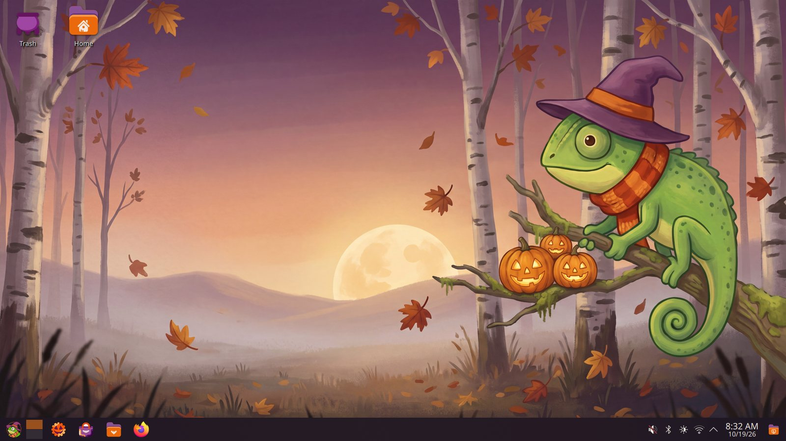

| | |
|---|---|
| 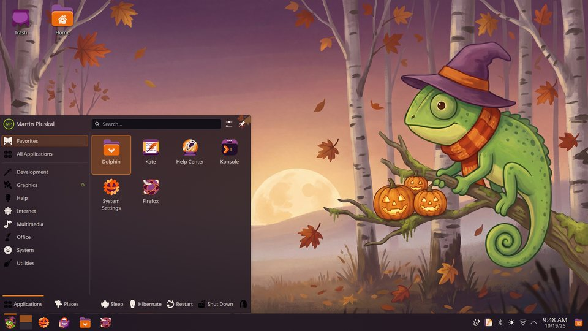 | 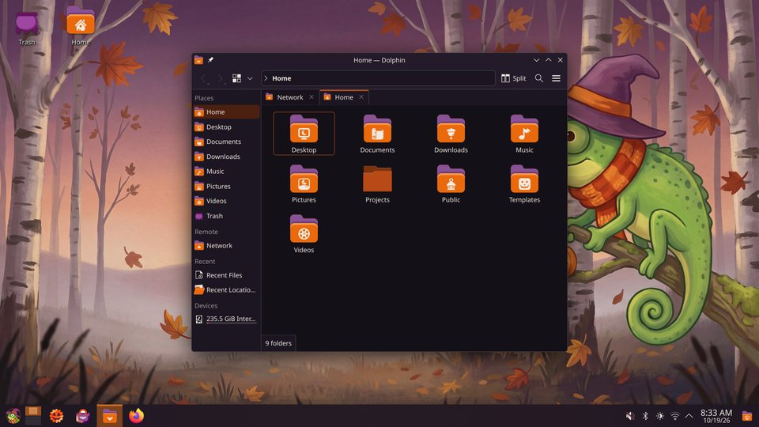 |
| App launcher | Dolphin with the folder icons |
|  | 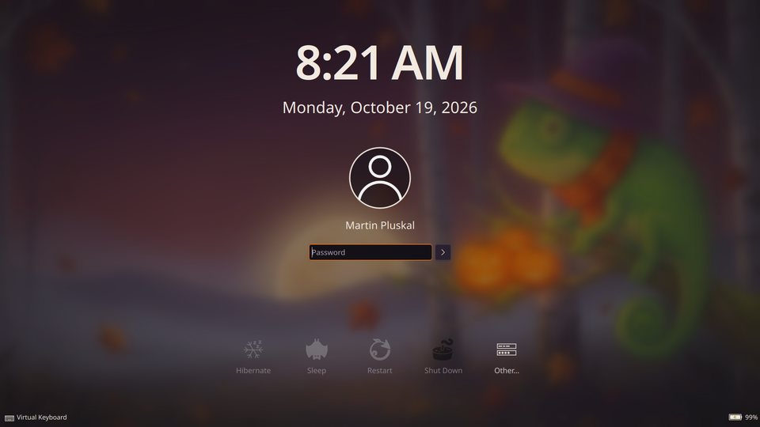 |
| The wallpaper at dusk | Login screen (SDDM) |
| 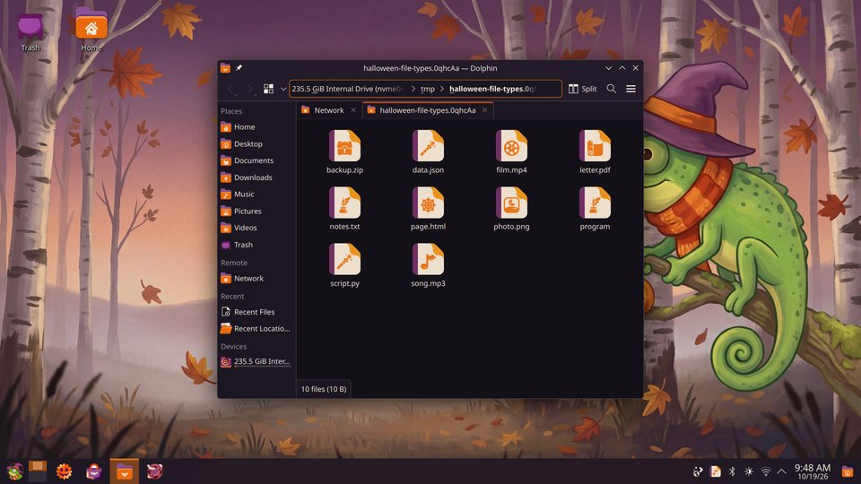 | 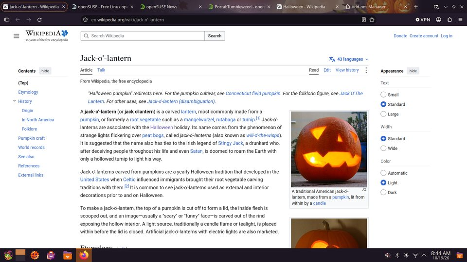 |
| File types | Firefox theme |
|  | 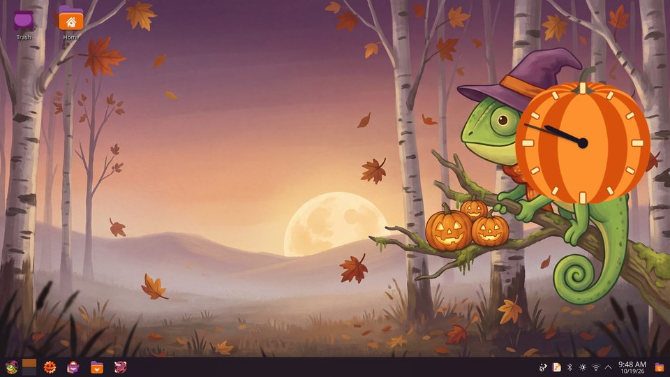 |
| Splash screen | Pumpkin clock |
| 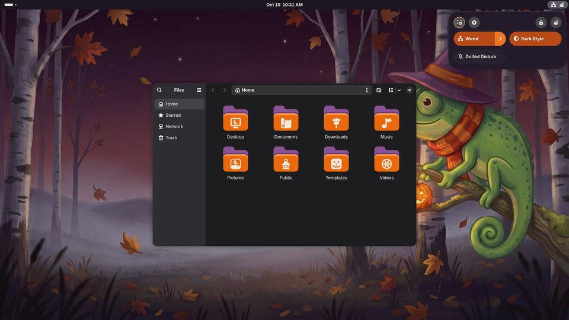 | 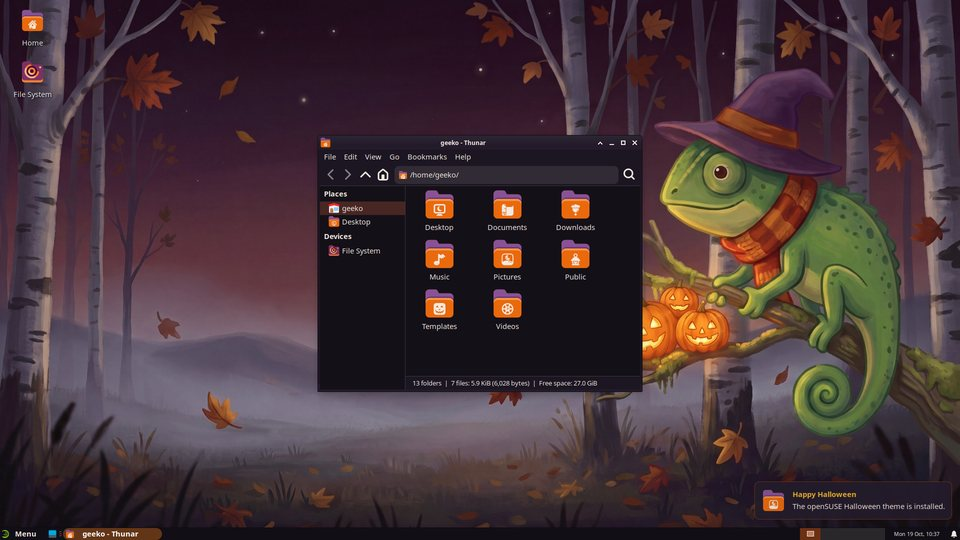 |
| GNOME | Xfce |
| 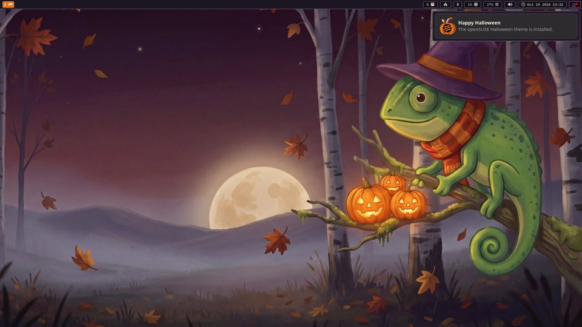 | 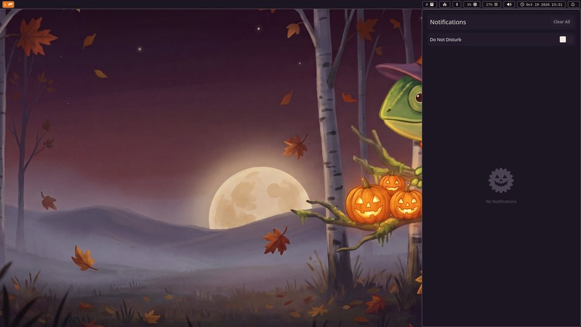 |
| Sway | swaync notification centre |
| 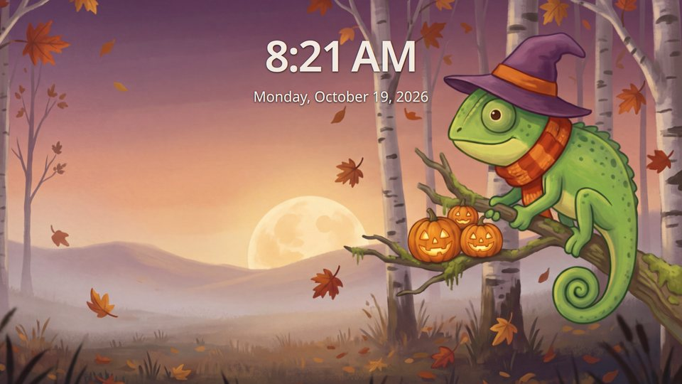 |  |
| Lock screen (Plasma) | GNOME apps |

## What's included

| Piece | ID | Works with |
|---|---|---|
| Wallpaper: dusk by day, moonlit by night | `openSUSEhalloween` | Plasma, GNOME (light and dark), Xfce |
| Plasma style: autumn colours, leaf sprig on popups, ember tooltip glow, pumpkin clock | `openSUSE-halloween` | Plasma |
| Colour scheme | `openSUSEHalloween` | Plasma and KDE apps |
| Global theme with a pumpkin splash screen | `org.openSUSE.halloween.desktop` | Plasma |
| Icon theme over Breeze Dark: folders, file types, drives and devices, trash, the apps KDE, GNOME and Xfce ship by default (files, terminal, settings, editor, calculator, clocks, mail (also Thunderbird), maps, music (also Spotify), videos and more) and YaST, System Settings' and Xfce's settings as glyphs carved into pumpkins and GNOME Settings' panels as one-colour glyphs, a web-browser icon (also for Firefox), code-editor and chat icons (VSCodium, Slack, Polari, NeoChat), app-menu and power icons | `openSUSE-halloween` | Plasma |
| The same icons over Adwaita | `openSUSE-halloween-adwaita` | GNOME, Xfce, Sway |
| GTK 3 theme: night colours with ember and pumpkin accents, built on [adw-gtk3](https://github.com/lassekongo83/adw-gtk3) | `openSUSE-halloween` | GNOME, Xfce, GTK 3 apps |
| GNOME Shell theme: top bar, menus, quick settings, calendar | `openSUSE-halloween` | GNOME with the User Themes extension |
| Window manager theme, also at 1.5× and 2× | `openSUSE-halloween`, `-hdpi`, `-xhdpi` | Xfce (xfwm4) |
| Notification theme | `openSUSE-halloween` | Xfce (xfce4-notifyd) |
| Login screen, built on openSUSE's `breeze-openSUSE` | `breeze-openSUSE-halloween` | SDDM |
| Boot splash | `openSUSE-halloween` | Plymouth |
| Firefox theme: plum toolbars, pumpkin accents, the moonlit forest behind the tabs | `openSUSE-halloween@pluskal.org` | Firefox |
| Sway colours and gaps, a Waybar stylesheet and a swaync notification theme | `openSUSE-halloween` | Sway, Waybar, swaync |

openSUSE's green and blue are replaced by an all-autumn palette
([`art/palette.toml`](art/palette.toml)); openSUSE green appears only on the
chameleon. All the pieces are dark, like the night they're named after;
libadwaita apps on GNOME keep their own colours but take the orange accent.
See [gnome/](gnome/) and [xfce/](xfce/) for what each edition covers.

## Requirements

- openSUSE Tumbleweed with KDE Plasma 6.8, GNOME 50 or Xfce 4.20 (or newer), or
  with Sway
- With Sway, Waybar and SwayNotificationCenter (`waybar`, `swaync`) for the bar
  and notifications
- For the GNOME Shell theme, the User Themes extension
  (`gnome-shell-extension-user-theme`)
- For the login screen, openSUSE's `breeze-openSUSE` SDDM theme
  (`plasma6-sddm-theme-openSUSE`), which it builds on
- To build: Python 3.11 or newer, `make` and [Git LFS](https://git-lfs.com/)

### Supported screens

These setups are supported, and `make check` fails if a change breaks them:

| Setup | What you get |
|---|---|
| 16:9 and 16:10, from 1366x768 to 5K | The whole scene, on every desktop and login screen |
| 3:2 laptops (2256x1504, 3000x2000, …) | The whole chameleon everywhere |
| 21:9 ultrawide, 4:3, 5:4 | Plasma: the whole chameleon, from a picture made for the shape. GNOME, Xfce and the login screens zoom one 16:10 picture: at least 80% of it |
| 32:9 and portrait (9:16) | Plasma: a picture made for the shape (on 32:9 the tail is cut). Elsewhere, pick the matching picture yourself (see below) |
| 100%, 150% and 200% scaling (HiDPI) | Sharp throughout: icons, styles and Shell theme are vector or CSS, wallpapers go up to 5K, login and splash backgrounds are 4K, the Firefox header is drawn at 2x, and the Xfce window manager theme comes at 1x, 1.5x and 2x |
| Boot splash, 720p to 4K and portrait | The passphrase prompt, the lantern and update messages never cover the chameleon |

The pictures for every shape are in
`/usr/share/wallpapers/openSUSEhalloween/contents/images{,_dark}/`, named by
size; GNOME and Xfce can use any of them instead of the default one in
`/usr/share/backgrounds/openSUSEhalloween/`.

## Install

### From the packages (openSUSE Tumbleweed)

The packages are built in the Open Build Service, in
[X11:Utilities](https://build.opensuse.org/package/show/X11:Utilities/halloween-openSUSE):

```bash
sudo zypper addrepo -f https://download.opensuse.org/repositories/X11:/Utilities/openSUSE_Tumbleweed/ X11_Utilities
sudo zypper install halloween-openSUSE
```

`halloween-openSUSE` is a metapackage: it brings the wallpapers, and each
piece comes along by itself when the system has what it is for (its
Supplements): the Plasma theme and icons with Plasma, the login theme with
openSUSE's SDDM theme, the GTK, GNOME Shell and Xfce themes and their icons
with GNOME, Xfce or Sway, the Sway, Waybar and swaync themes with Sway, the
boot splash with Plymouth, the Firefox theme with Firefox. Where recommended packages are switched off (some minimal images
set `solver.onlyRequires`), use `zypper install --recommends`. Installing
only puts files in place; the SDDM and GNOME defaults packages make the
theme the default there, and your own choices still win.

| Package | What it installs |
|---|---|
| `halloween-openSUSE-wallpapers` | wallpapers, GNOME backgrounds |
| `halloween-openSUSE-icon-theme` | icon theme over Breeze (Plasma) |
| `halloween-openSUSE-adwaita-icon-theme` | the same icons over Adwaita (GNOME, Xfce, Sway) |
| `halloween-openSUSE-plasma` | colour scheme, Plasma style, global theme with splash |
| `halloween-openSUSE-sddm-theme`, `-sddm-defaults` | login theme, and it as SDDM's default |
| `halloween-openSUSE-plymouth-theme` | boot splash (choosing it stays with you) |
| `halloween-openSUSE-gtk3-theme` | GTK 3, GNOME Shell, xfwm4 and notification themes |
| `halloween-openSUSE-gnome-defaults` | GNOME defaults: accent, dark style, wallpaper, Shell theme name |
| `halloween-openSUSE-sway-theme` | Sway colours, borders and gaps, Waybar and swaync stylesheets |
| `halloween-openSUSE-firefox-theme` | the Firefox theme |

### From source

The build installs the same way: `make install` only copies files into the
system folders and changes no settings.

```bash
git lfs install && git lfs pull
make check                   # build into build/ and validate it
sudo make install            # copy the theme to /usr/share and /usr/lib64
sudo make install-defaults   # optional: make it the default (login screen, GNOME)
```

### Then pick it

- **Plasma:** System Settings → *Colors & Themes* → *Global Theme* →
  *openSUSE Halloween*. It brings the Plasma style, colours, icons, splash
  screen and wallpaper; leave *Use desktop layout from theme* unticked to
  keep your panels.
- **Login screen:** System Settings → *Colors & Themes* → *Login Screen
  (SDDM)* → *openSUSE Halloween*, or `make install-defaults`, which adds
  the vendor default `/usr/lib/sddm/sddm.conf.d/30-breeze-openSUSE-halloween.conf`
  (a login screen picked in System Settings still wins).
- **GNOME:** in Settings → *Appearance*, pick the dark style, the orange
  accent and the *openSUSE Halloween* background. In GNOME Tweaks →
  *Appearance*, pick `openSUSE-halloween` for *Legacy Applications* and *Shell*
  (with the User Themes extension enabled), and `openSUSE-halloween-adwaita`
  for *Icons*. `make install-defaults` adds a GSettings override (run
  `glib-compile-schemas /usr/share/glib-2.0/schemas` after it) with the dark
  style, the orange accent, also on the login screen (GDM), the wallpaper and
  the Shell theme's name, for everyone who hasn't chosen otherwise; the GTK
  theme, the icons and the User Themes extension stay your choice in Tweaks.
  GDM's background can't be changed.
- **Xfce:** in Settings → *Appearance* pick `openSUSE-halloween` (style) and
  `openSUSE-halloween-adwaita` (icons); in *Window Manager* pick
  `openSUSE-halloween` (or `-hdpi` / `-xhdpi` with display scaling); in
  *Notifications* pick `openSUSE-halloween`; and in *Desktop* choose
  `/usr/share/backgrounds/openSUSEhalloween/night.jpg`, or the picture for
  your screen's shape from `/usr/share/wallpapers/openSUSEhalloween/contents/images_dark/`.
  Xfce's defaults come from openSUSE's branding packages, so there are none
  to install. For the login screen (LightDM), an administrator can set
  `theme-name=openSUSE-halloween`, `icon-theme-name=openSUSE-halloween-adwaita`
  and a `background=` from the wallpaper in `/etc/lightdm/lightdm-gtk-greeter.conf`.
- **Sway:** add `include /usr/share/openSUSE-halloween/sway/theme` at the end
  of your `~/.config/sway/config`: it sets window colours, borders and gaps,
  and leaves your bar as it is. For the wallpaper, add
  `output * bg /usr/share/backgrounds/openSUSEhalloween/night.jpg fill`. For
  Waybar and SwayNotificationCenter, copy
  `/usr/share/openSUSE-halloween/waybar/style.css` to `~/.config/waybar/` and
  `/usr/share/openSUSE-halloween/swaync/style.css` to `~/.config/swaync/`;
  their config files stay yours. GTK apps take the GTK theme and icons from
  GSettings: `gsettings set org.gnome.desktop.interface gtk-theme
  openSUSE-halloween` and `gsettings set org.gnome.desktop.interface
  icon-theme openSUSE-halloween-adwaita`.
- **Keyboard layout:** where IBus runs (it comes with GNOME), it draws the
  layout, such as "EN", in the panel itself, blue unless told otherwise.
  `make install-defaults` makes it the theme's cream; or, for one user,
  `gsettings set org.freedesktop.ibus.panel xkb-icon-rgba '#F2E9E1'`.
- **Boot splash:** note the current theme (`plymouth-set-default-theme`), then
  switch and rebuild the initrds:

  ```bash
  sudo plymouth-set-default-theme openSUSE-halloween
  sudo sdbootutil mkinitrd        # systemd-boot; with GRUB: sudo dracut -f --regenerate-all
  ```

- **Firefox:** `make install` puts the theme into openSUSE Firefox's own
  add-on folder. Restart Firefox and pick it in `about:addons` → *Themes*.
  See [Firefox](#firefox) for other Firefox builds.

### Uninstall

Switch the global theme, login screen and boot splash back first (their files
go away), then:

```bash
sudo zypper remove 'halloween-openSUSE*'   # the packages
sudo make uninstall                        # or, from source: every installed file, the defaults included
```

### If the boot splash causes trouble

- Press <kbd>Esc</kbd> during boot to see the text log.
- Hold <kbd>Space</kbd> at power-on to open the systemd-boot menu and pick an
  older snapshot, or press <kbd>e</kbd> and add `plymouth.enable=0`.
- From a text console (<kbd>Ctrl</kbd>+<kbd>Alt</kbd>+<kbd>F3</kbd>), switch
  back with `plymouth-set-default-theme` and rebuild the initrds as above.

### Firefox

The theme only recolours Firefox; Firefox's own logo stays as it is. The
`.xpi` (`build/firefox/openSUSE-halloween.xpi`) isn't signed by Mozilla, and
regular Firefox releases only install signed add-ons:

- **openSUSE's Firefox:** it is built to load unsigned add-ons only from its
  own folder, which is where `make install` puts the theme
  (`/usr/lib64/firefox/browser/extensions/openSUSE-halloween@pluskal.org.xpi`).
  Only put files there that you built or trust.
- **Firefox Developer Edition, Nightly or ESR:** set
  `xpinstall.signatures.required` to `false` in `about:config`, then choose
  ⚙ → *Install Add-on From File…* in `about:addons`.
- **Any Firefox, until it restarts:** choose *Load Temporary Add-on…* in
  `about:debugging#/runtime/this-firefox`.

## Contributing

Contributions are welcome: new icons, fixes, other desktops. Start with
[CONTRIBUTING.md](CONTRIBUTING.md), which covers the development setup, how
the build works and how to propose artwork. AI coding agents should read
[AGENTS.md](AGENTS.md). Everyone is expected to follow the
[code of conduct](CODE_OF_CONDUCT.md).

```bash
make check   # build everything into build/ and validate it
make lint    # ruff, ShellCheck, workflow, spelling and licence checks
```

How the pieces fit together is in [docs/architecture.md](docs/architecture.md).

## Roadmap

- The packages in openSUSE Tumbleweed itself, submitted from X11:Utilities

## About the artwork

The artwork is made with generative AI (Picsart: Flux 2 Pro, Nano Banana 2 and
Recraft), then selected, cut out, retouched and composed by hand: every folder
icon is assembled from a master folder and an emblem, crops and colours are
adjusted by the build tools. Every prompt, model, setting and choice is
recorded in [`art/prompts/`](art/prompts/).

Purely AI-generated material may not be protected by copyright in some
countries (see the US Copyright Office's 2025 report on copyrightability). The
licence below covers the human selection, composition and editing.

## Trademarks

openSUSE and the openSUSE logo are trademarks of SUSE LLC. This project is
not affiliated with or endorsed by SUSE or the openSUSE Project. The chameleon
is an original character inspired by the Geeko; it is not the openSUSE logo
or a modification of it.

Firefox is a trademark of the Mozilla Foundation. The Firefox theme only sets
colours and a header image, and the icon theme's web-browser icon is an
original drawing, not Firefox's logo.

## Credits

- KDE Visual Design Group: Breeze, the Breeze Plasma style and splash
- openSUSE KDE team: the `breeze-openSUSE` login theme and Plasma branding
- Plymouth: the two-step plugin and the spinner theme's dialog images
- lassekongo83 and the adw-gtk3 contributors: adw-gtk3, which the GTK 3 theme
  is built on
- Olivier Fourdan and the Xfce team: xfwm4's default theme, which the window
  manager theme recolours

## Licence

[REUSE](https://reuse.software)-compliant: every file's licence is in its
header or in [`REUSE.toml`](REUSE.toml), and the texts are in
[`LICENSES/`](LICENSES/).

- Artwork, including the icons and the Firefox theme: CC-BY-SA-4.0
- Plasma style and colour scheme: LGPL-2.0-or-later (derived from Breeze)
- GTK 3 theme: LGPL-2.1-only, as adw-gtk3, which it recolours
- SDDM login theme: CC-BY-SA-4.0 (its background) and CC0-1.0 (its
  configuration); the QML it links is openSUSE's `breeze-openSUSE`
- Splash, look-and-feel, Plymouth theme, GNOME Shell stylesheet, Xfce window
  manager and notification themes, tools and scripts: GPL-2.0-or-later
- Documentation and small configuration files: CC0-1.0
